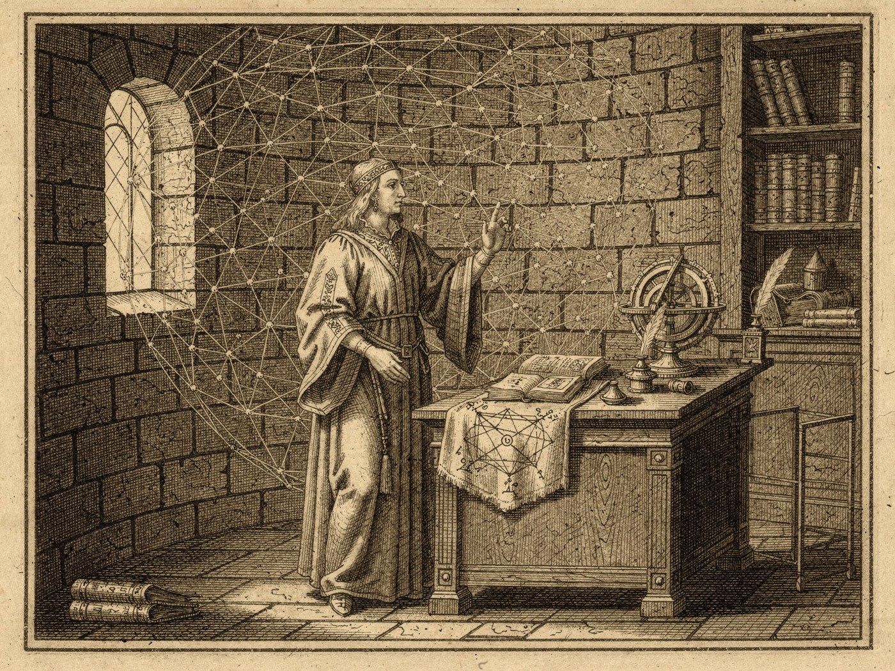
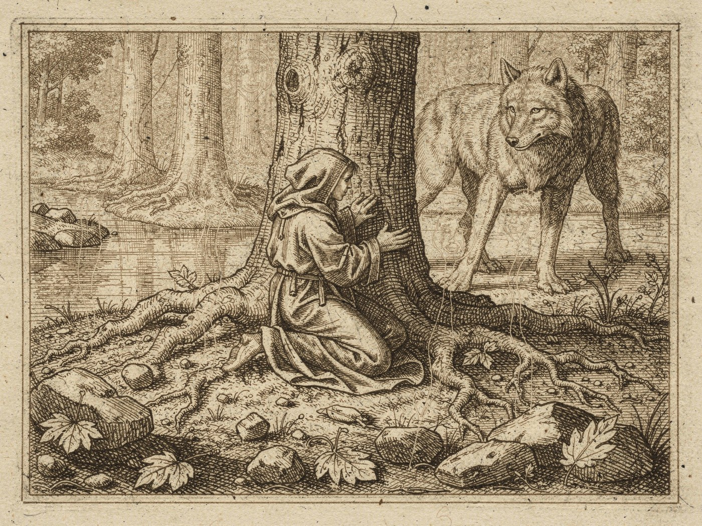
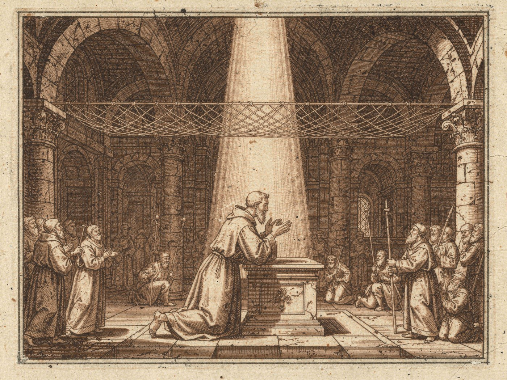
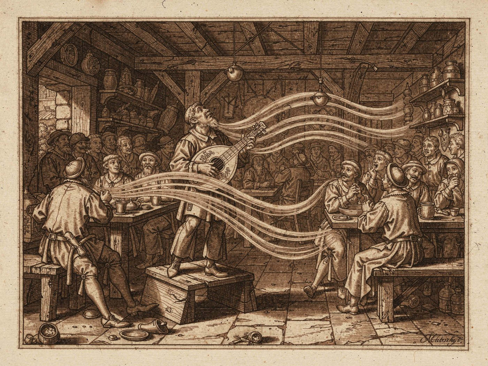

# Metafizik ve Büyüsel Etkileşimler

En mütevazı ışık arzusundan tanrılardan lütuf dilemeye varıncaya dek, olağanın dışına taşan her hadiseye halk tek bir ad verir: büyü. Bu ad yanlış değildir ama eksiktir. Zira fevkalade olan her şey büyüsel bir işlemden doğmaz; bir rahibin müjdesi, bir ozanın sahnesi, bir büyücünün ağdaki hamlesi ve bir druidin yabanla konuşması aynı gözle izlendiğinde birbirinden ayırt edilmez. Avamın gözünde aralarında zahiri bir fark yoktur. Hakikatte ise bu dördü ayrı kaynaklardan beslenir, ayrı kurallara bağlıdır ve ayrı bedeller öder.

Bu satırları, Archantus Büyücü Okulu’nda yıllarca ağı okumuş ve okutmuş biri olarak, öğrencilerimin her yıl aynı karışıklığa düşmesinden usandığım için yazıyorum. Maksadım bir yolu ötekinden üstün göstermek değil, her birinin gücünü nereden aldığını göstermektir. Bir büyücü olarak kendi yolumu daha iyi bildiğimi saklamayacağım; diğerleri hakkında söylediklerim gözlemdir, itiraf değil.

## Büyücüler ve Ağ

Carya kurulduğunda altında baştan beri bir örgü vardı; ne yaratılmış ne yerleştirilmiş, yalnızca orada duran ince bir ağ. Tanrılar ona dokunabildi ama üstünde durmadı, çünkü tanrı gücünü ağdan almaz. Ağın çağlar boyunca düzenli ve öğrenilebilir kalması önce Loth ile Praxaclass’ın emeğidir; bugün ise ağ Arcan’ın elindedir. Büyücünün bütün sanatı bu örgüyü okumak ve onu bir anlığına bükmektir.

Ağ rastgele dokunmuş değildir. İlmekler belli düğümlerde buluşur, düğümler belli kalıplarda sıralanır; her kalıp bir etkinin tohumudur. Büyücü önce bu kalıpları ezberler, sonra hesaplar: hangi ilmeği ne kadar gereceğini, hangi düğümü hangisinden önce çözeceğini, gerilimin örgüde nereye kaçacağını. Bunun için kâğıt üstünde sayısız şekil çizilir, cetveller tutulur, kalıplar kuşaktan kuşağa defterlere geçirilir. Bir büyü, ezbere bilinen bir kalıbın doğru sözle, doğru hareketle ve doğru zihin düzeniyle ağa bastırılmasıdır. Zihin ne kadar berrak, hesap ne kadar temizse etki o kadar keskin olur.

Bu yüzden büyü bir yetenekten çok bir disiplindir. Okulda ilk yıllar hiç büyü yapılmadan geçer; öğrenci yalnızca ağın şeklini görmeyi öğrenir. Arcan’ın kendisi de bu yoldan yükselmiştir: Koran adlı ölümlü bir büyücü, ağdaki eğilmeyi kendi çalışmasıyla fark etmeseydi, örgü bugün başka ellerde olurdu. Ağı bilmek, onu korumanın da ilk şartıdır.

### Efsuncular Üzerine Bir Not

Bazıları ağı hiç hesap etmeden büker. Efsuncu denen bu kişiler gücü doğuştan, içgüdüyle kullanır; ağ onların elinde bir hesap değil bir uzuv gibidir. Mystra hanesi bunun en bilinen örneğidir. Kalıpları bilmeden kullandıkları için ustalıkları çoğu zaman şaşırtıcı, hataları ise çoğu zaman pahalıdır. Ağın kendisi aynıdır; değişen yalnızca ona nasıl dokunulduğudur.

## Druidler ve Yabanın Ruhları

Druidin gücü ağdan gelmez. Carya’nın kalbinde uyanan Viridia, Tiamat’ın bekçiliği ile doğanın dengesini aynı anda taşıyamayınca kendinden suretler bıraktı. Küçük olanları ormanlara, nehirlere, dağ geçitlerine sindi; bugün doğa ruhları olarak bilinirler. Büyükleri, Greatwolf ve Kraken gibi, kendilerine inananların kudretiyle neredeyse tanrı mertebesine ulaştı. Druid işte bu ruhlarla konuşur.

Bu bir hesap değil, bir tanışıklıktır. Druid belli bir ormanın, belli bir ırmağın ruhunu yıllarca dinler, onun ritmine ayak uydurur, onun güvenini kazanır. Bitkiyi büyüten, rüzgârı çeviren, bir ormanı ayağa kaldıran druidin kendisi değil, onun sesine kulak veren ruhtur. Bu yüzden druidin gücü yerden yere değişir: kendi toprağında bir orduyu durdurabilir, yabancı bir ormanda ise sıradan bir yolcudan farksız kalabilir. Diken Çemberi’nin kollara bölünmesi de bundandır; her kol kendi ruhunun huyunu taşır.

Viridia’nın suretleri çoğu zaman dengesizdir. Bir ruhun öfkesi druidin öfkesine dönüşebilir; bir ruhun kayıtsızlığı da en büyük druidi bir anda yalnız bırakabilir. Biz büyücüler ağın kurallarına güveniriz. Druid ise ancak bir dostun sözüne güvenir.

## Rahipler ve Kutsal Kaynak

Rahibin gücü de ağdan gelmez; tanrının kendi kutsal kaynağından iner. Tanrılar Carya’yı kurarken ağa ilgi göstermedi, çünkü ona ihtiyaçları yoktu. Rahip bu ilgisizliğin mirasçısıdır: Duası örgünün içinden değil, örgünün üstünden geçer.

Rahibin işi, kendini tanrısının iradesine açık bir kap hâline getirmektir. Dua ritüelleri, semboller, oruçlar ve yeminler bu kabı temizlemenin yollarıdır. Kap ne kadar temizse lütuf o kadar bol iner. Ama son söz her zaman tanrıya aittir. Bir rahip en doğru duayı en doğru biçimde okuyup yine de cevap alamayabilir; Alarath’ın kudretinin çoğunu Amarath’ı yaşatmaya harcadığı bu çağda bunu en iyi şifacı rahipler bilir.

Rahiplerin büyücülere karşı üstünlüğü de zaafı da buradadır. Ağ bozulsa, Loth ile Vilgax’ın düğümleri yeniden çekilse bile tanrının lütfu iner. Fakat tanrı sustuğunda, ne kadar bilgili olursa olsun hiçbir rahip onu konuşturamaz.

## Ozanlar ve Sesin Yankısı

Ozanların gücü dördünün en tartışılanıdır. Bizim okulda yaygın kanaat şudur: Ses de ağa dokunur. Bir nota ilmeği titretir, bir ezgi bir kalıbı uyandırır. Ozan bunu hesapla değil kulakla yapar; büyücünün kâğıt üstünde çözdüğü kalıbı o bir şarkının içinde duyar.

Ne var ki ozanın asıl alanı ağdan çok dinleyenin kalbidir. Doğru anda söylenen doğru bir türkü bir askeri cesaretlendirir, bir kalabalığı kışkırtır, bir kahramanı göklere çıkarır ya da yerin dibine batırır. Bunun ne kadarının büyü, ne kadarının ustalık olduğunu ozanların kendisi de kesin bilmez. Ölü Ozanlar Derneği’nin on yıllık çıraklığı, bu iki şeyi birbirinden ayırmayı değil, ikisini aynı anda taşımayı öğretir. Sanatın ve oyunun tanrıları Fulgrim ile Cegorah’a ozanlar arasında sık rastlanması da tesadüf değildir.

## Son Söz

Dört yol, dört kaynak: büyücü ağı okur, druid ruhla konuşur, rahip tanrıya açılır, ozan kalbe dokunur. Avam bunları aynı sanır; çoğu zaman sonuç da aynıdır. Fakat bir yolun kurallarını ötekine uygulayan kendini tehlikeye atar. Ağı bir dua gibi bekleyen büyücü hiçbir şey alamaz; ruhu bir kalıp gibi zorlayan druid onu küstürür.

Son olarak öğrencilerime şunu hatırlatırım: Ağ Arcan’ın elindedir, ama örgünün derinlerinde Loth ile Vilgax’ın bıraktığı düğümlerin hâlâ durduğunu söyleyenler vardır. Okulda tanımadığınız bir kalıba rastlarsanız onu çözmeye çalışmayın, haber verin. Merak büyücünün en büyük erdemidir; ama o düğümlerin peşine düşenlerin çoğu uzun yaşamaz.

*Antimus Latvrosk, Archantus Büyücü Okulu müderrisi, Arcan’s Gate*
