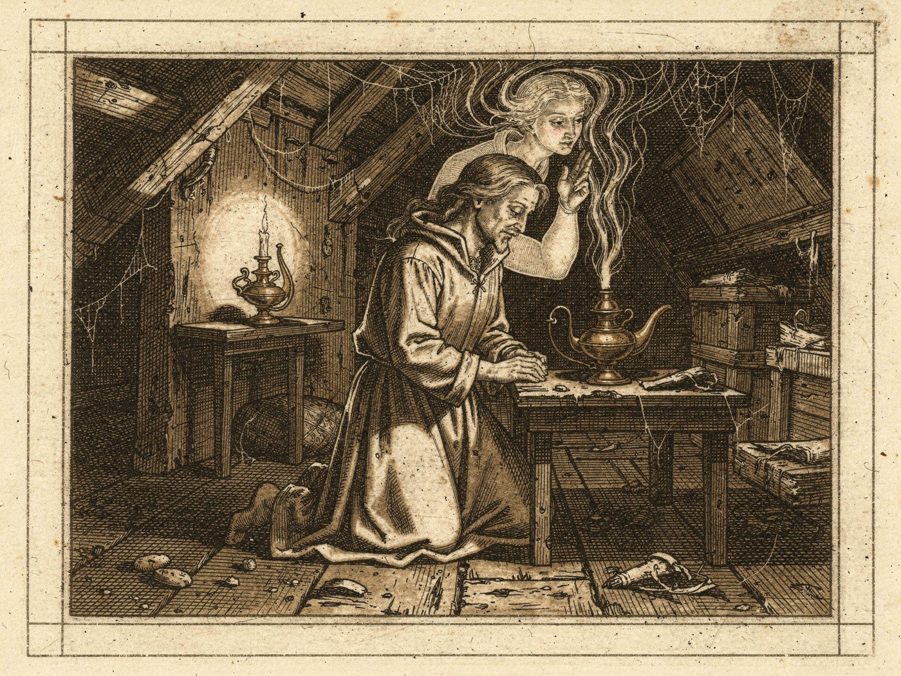
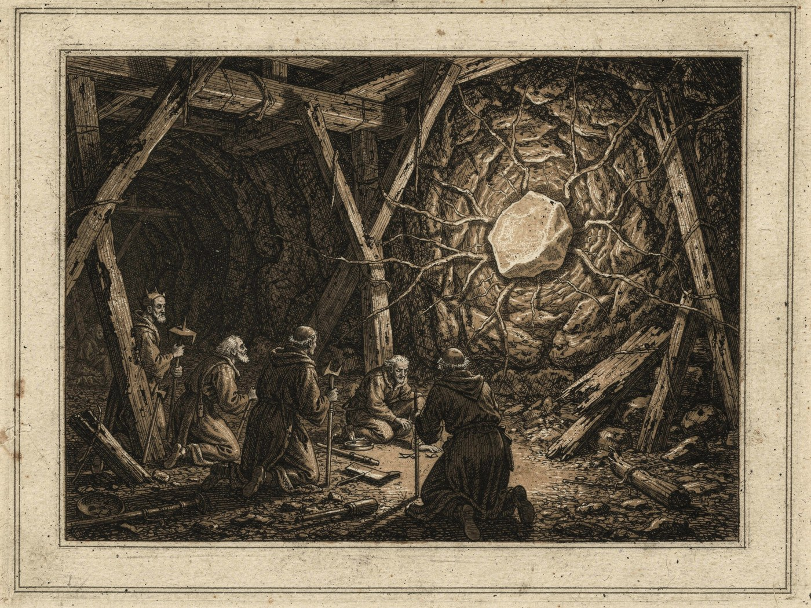
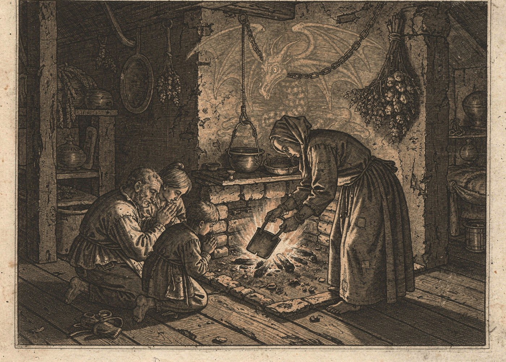
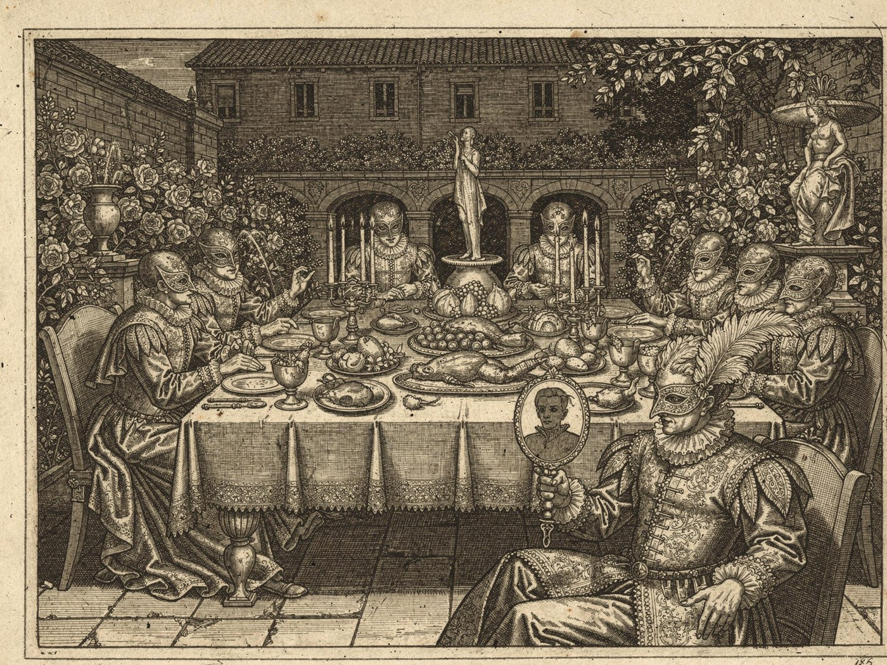
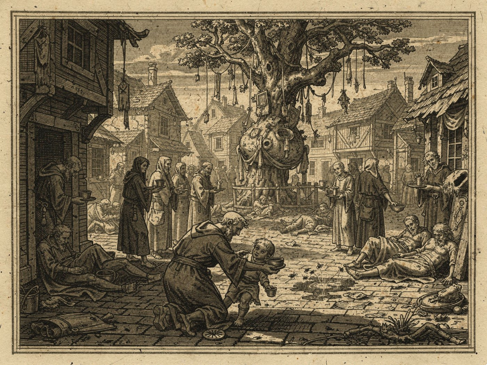
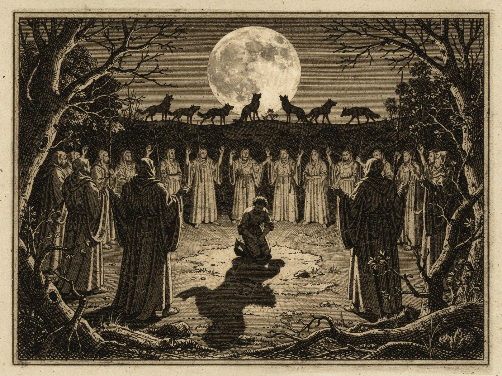
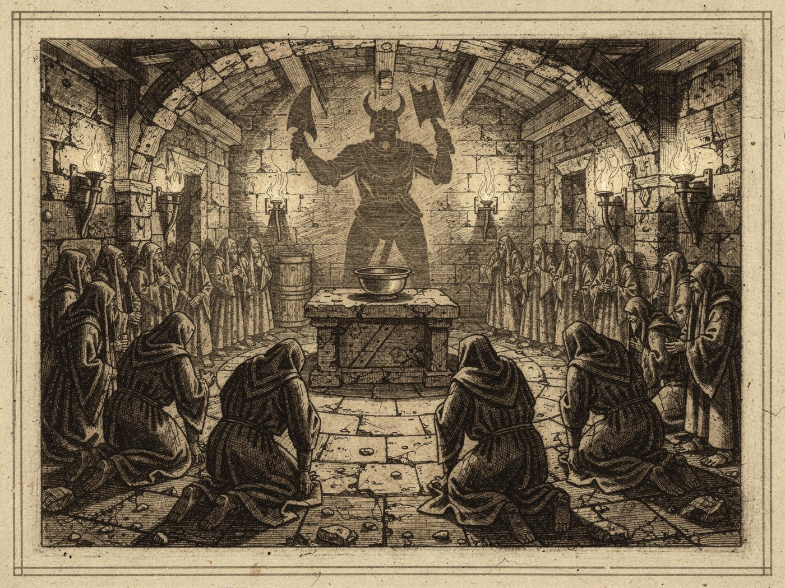

# Uyarı

Bu külliyat gayet hassas bilgiler ihtiva eder. Eğer kuvvetli bir ruha ve sağlam bir imana sahip değilseniz bu sayfaları okumayınız; kitabı en yakın Yeryüzü Tapınağı rahibine götürünüz. Bu sizin için bir ibadet sayılacaktır.

Bu külliyatta sapkın tarikatlar hakkında malumat verilmiştir, tâ ki onların zehirli iddialarına karşı imanınız emniyette olsun. Bir zehri tanımayan ondan sakınamaz; ama zehri tanımak için onu tatmak da gerekmez. Bu kitabı tadılmamış bir zehrin tarifi olarak okuyunuz.

Külliyatın bazı yerlerinde bana gönderilen mektuplar bulunur. Bazı yerlerinde tarihten nakiller yapılmıştır. Bazı yerlerinde ise derslerimde fidanlarla aramızda geçen münakaşa ve mütalaalar yer alır.

# Sonradan Eklenen Önsöz

Bu külliyat üç cihetten bir mucize olduğunu göstermiştir.

Evvela, bu külliyat tanrıların inayetiyle müthiş bir süratte, ezberden ve acemi fidanlarla birlikte, mucizevi bir kolaylıkla ve hatasız yazılmıştır. Kütüphane Kolu’nun istinsah ettiği nüshalarda bile tek bir yanlışa rastlanmamıştır.

Saniyen, bu kitabı okuyan rahiplerin cümlesinin takdiri ve alakası onun doğruluğuna delalet eder. Kütüphane Kolu kitabı Florentina’daki Yeryüzü Tapınağı’nın kadim raflarına kabul etmiştir; bu raflara bir kitabın girmesi, ancak tanrıların rızasıyla olur.

Salisen, şahsım her mevzuda yeterli malumata sahip olmasa da, her yeni fasla başlarken o mevzuya dair mektuplar diyarın dört bir yanından, benim talebim olmaksızın ve tesadüfen bana ulaşmıştır. Bu derece bir tesadüf ancak mucize ile izah olunabilir.

# Birinci Fasıl: Şeytana Tapanlar ve Onlarla Ahitleşenler

Şeytana tapanlar aşağılıkların en aşağılığıdır. Zira cehennemin mahlukları yaradılışları gereği kendilerinden gayrı her şeyi aşağı görür. Onlara tapan kimse bu kaideyi kabul etmiş olur; o hâlde kendini şeytandan da aşağı saymış demektir. Şeytan ise kendini üstün görür ama öyle değildir; bu yüzden o da aşağılıktır. Netice şudur: Şeytana tapan ve onunla ahitleşen, aşağılıktan da aşağıdadır.

Bilinmelidir ki bugün cehennemin dört alanı vardır ve her biri bir Kaos tanrısına aittir. Amarath o yeri Kaos’a yönelenleri cezalandırmak için kurmuştu; Horus’un İsyanı’ndan sonra ise Khorn, Slanesh, Zinch ve Nurgle onu kendi aralarında bölüştü. Bugün cehennemde bir ahit yapan kimse, ahdin karşısında hangi şeytan durursa dursun, nihayetinde o dört illetten birine ahit vermiş olur. Ahdin bedelini de çoğu zaman ruhuyla öder; o ruh bir daha Ruhlar Nehri’ne ulaşmaz.

Şeytanla ahitleşmek yahut ona tapmak, Işık Yolcularının yolundan çıkmaktır. Bunun erdemli hiçbir tarafı yoktur. Zaten şeytani tarikatların cümlesi, Yeryüzü Tapınağı’nın Carya’ya nizam ve huzur getirme gayesine karşı durur.

Bu mevzuda bir fidanımla mütalaamız:

> Fidan: Hocam, şeytanların gayesinin Carya’yı fenalığa sürüklemek olduğunu neden peşinen kabul ettiniz? Bunun aksine hareket eden şeytanlar yok mudur?
>
> Elcevap: Tarihte görülmemiştir ki bir şeytan tarikatı Carya’ya kan ve gözyaşından gayrı bir şey getirmiş olsun. Yalnızca imparatorluğun tarihinde değil, bütün medeni halkların tarihinde, hatta Kuzey Krallığı’nın ve Özgür Şehirler’in kayıtlarında dahi şeytanlar huzur getirmemiş, aksine keder ve sıkıntıya sebep olmuşlardır. Bir şeytanın iyilik ettiği görülmüşse, o iyilik daha büyük bir kötülüğün peşinatıdır.

# İkinci Fasıl: Cin ve Gölge Tarikatları

Cinler ne melektir ne şeytan. Nereden geldikleri bilinmez; kendi maksatlarının peşindedirler. Ekserisi bir cisme, bir kandile, bir yüzüğe, bir taşa bağlı ve hapistir; cisimden kurtulanlar ise Carya’ya yakın manevi âlemde dilediklerince dolaşır. Cinlere tapan tarikatlar, bu varlıkların kudretini tanrı kudreti sanan gafillerdir.

Cin tarikatları aklın ve iradenin, ruhun ve istidadın hükümsüz kalmasına yol açtığı için sapkındır. Bu yol, kişiden Amarath ile Alarath’ın ona bahşettiği ruhu yavaş yavaş alır. Cine kendini adayan kimse önce dileğini, sonra arzusunu, en sonunda da kendi sesini ona teslim eder. Cinler tanrılarımızın ne dostu ne düşmanıdır; lakin onların Carya’nın işlerine karışması yaradılışları gereği yanlıştır. Zira onların âleminin kanunları ile bizim kanunlarımız birbirinden farklıdır ve arada bir perde vardır. O perdeyi yırtmaya çalışan her ayin, perdenin öbür yanındakilere bir kapı açar.

Gölge tarikatları da cin tarikatlarına benzer, lakin daha fenadır. Bunlar Loth’un yolunu tutanlardır: güneşten kaçan, yerin altına çekilen ve karanlığı arzulayanlar. Loth bir zamanlar ağın sadık düzenleyicisiydi; sonra Isha’nın kanını eline bulaştırdı, kader tabletlerini kırdı ve yeraltına çekildi. Onun yolundakiler de kaderi kendi elleriyle yazabileceklerini zanneder. Karanlık adaleti güçleştirir; elması kömürden ayırt etmeyi güçleştirir. Karanlığı arzulayan kimse, ilk önce kendi suçunun görünmemesini arzular.

# Üçüncü Fasıl: Düşük Aydınlık Tarikatı

Bu esrarengiz tarikat, karanlığın içinde bir aydınlık ararken sapkınlığa düşmüş bir cemaattir. Venture’a bağlı Kuştepe’nin terk edilmiş maden damarlarının derinlerinde toplandıkları söylenir. Rivayete göre madenciler bir gün kayanın içinde, hiçbir kandilin ulaşmadığı yerde kendi kendine parlayan soluk bir taş bulmuşlardır. Tarikatın lideri, o taşın içinde gizli eski bir varlıkla konuştuğuna inanır. Mensuplar ayinler ve gizli törenlerle bu varlıkla bağ kurmaya çalışır ve onun yönlendirmesiyle dünyadaki muvazeneyi bozmaya uğraşırlar.

Düşük Aydınlık Tarikatı’nın gayesi, karanlığın içine gizlenmiş bir nuru bulup dünyaya çıkarmak ve onun kudretini ele geçirmektir. Bu sapkınlığı birkaç cihetten çürütmek mümkündür.

- **Karartılmış iman:** Tarikat, tanrılarımızın nurunu bırakıp kaynağı meçhul bir ışığa döner. Kaynağı bilinmeyen bir ışık, kaynağı bilinmeyen bir karanlıktan daha emniyetli değildir.
- **Aydınlanma vehmi:** Hakiki nur, Işık Yolcularının yolunda yürüyene kendiliğinden gelir; yerin dibinde kazılarak bulunmaz. Karanlıkta aranan ışık, insanı aydınlatmaz; yalnızca gözünü karanlığa alıştırır.
- **Gizli el:** Taşın içindeki varlık, mensuplarını kendi maksadına göre kullanır. Onlara ne verdiğini söyler, ne aldığını söylemez. Tarikata girenlerin zamanla kendi iradelerini kaybettikleri, ailelerini tanımaz hâle geldikleri rivayet olunur.
- **Diyarın emniyeti:** Bu ayinler yalnızca mensuplara değil, bütün Kuştepe’ye ve ötesine tehlike getirir. Yerin altında uyuyan şeyi uyandırmak, onu yeniden uyutmaktan her zaman daha kolaydır.

Bu taşın aslı hakkında bir şey yazmayacağım. Yalnızca şunu söyleyeyim: Kadim rivayetlerde yerin çok altına tohum ekip sessizce bekleyen bir el anılır. O el hakkında bilinen çok azdır; bilinen az şey ise çoğunlukla söylenmez. Bu sebeple insanlar Düşük Aydınlık Tarikatı’nın vaatlerine karşı uyanık olmalı ve tanrılarımızın nizamına sadık kalmalıdır.

# Dördüncü Fasıl: Zincirin Çocukları, Yahut Tiamat Tarikatı

Bu fasla başlamadan evvel itiraf edeyim ki tarikatların cümlesi içinde en çok bu tarikattan çekinirim. Şeytana tapan kimse ne yaptığını bilir; kalbinin bir köşesinde yaptığının fena olduğunu da bilir. Tiamat’ın yolunu tutan ise kendini mazlum sanır. Zalimi ikna etmek kolaydır, zira o zaten haksız olduğunu bilir; mazlum olduğuna inanmış kimseyi ikna etmek ise pek güçtür.

Tarihten nakledelim. Carya kurulduğunda herkesten önce Nehrin yukarısından Tiamat geldi. İlk anlaşma onunla yapıldı: Çocuklarını bu topraklarda büyütecek ve bu hakkı kimseyle paylaşmayacaktı. Sonra Nehrin aşağısından Alarath ile Amarath, ardından ötekiler geldi ve Rahsan her birine “evet” dedi. Tiamat sözün çiğnendiğini ilan edip savaş açtı. Ateş Savaşı böyle başladı. Savaşın sonunda Tiamat öldürülemedi ama zincire vuruldu; bekçiliği Viridia’ya verildi. Ejderhalar onun çocuklarıydı. Bugün ejderhalar yoktur; en sonuncusunun görüldüğü vakit bin yıldan eskidir. Ama ejderhaların yokluğu, onların davasının da öldüğü manasına gelmez.

Tiamat tarikatının mensupları kendilerine “zincirin çocukları” der. Bunlar ekseriyetle büyük şehirlerin değil, unutulmuş köşelerin insanlarıdır: toprağını kaybetmiş köylüler, mirası elinden alınmış ikinci oğullar, bir hanenin gölgesinde ezilmiş küçük soylular. Hepsinin ortak noktası bir haksızlığa uğradığına inanmasıdır. Tarikat onlara yeni bir şey vaat etmez; yalnızca öfkelerine bir isim verir. Ellerinde dolaşan dua kitabı ince bir defterdir. Ben onun bir nüshasını, Serenquill’de bir mahzende bulunup tapınağa getirildiği zaman okudum. Kısa cümlelerden müteşekkildir ve bir duadan çok bir yemin gibi okunur.

Bu kitaptan birkaç sözü burada nakledeceğim, tâ ki okuyan onları bir gün duyduğunda tanısın ve nasıl cevap vereceğini bilsin.

> İlk gelenin hakkı silinmez — zincirler geçer, hak geçmez.

Bu sözün ilk yarısı doğrudur, ikinci yarısı yalandır. İlk gelenin hakkı vardı; bunu inkâr etmeyeceğim. Lakin hak, sahibinin onu nasıl kullandığıyla da ölçülür. Tiamat hakkını aramak için müzakereyi değil ateşi seçti. Asuryani’yi altı parçaya bölen darbeyi o indirdi. Hakkı ateşle aranan bir davanın bedelini, o davadan haberi bile olmayanlar öder.

> Sessizlik cevap değildir. Sessizlik, sabırdır.

Tarikatın en tehlikeli sözü budur. Zira bu söz mensuba beklemeyi öğretir ve bekleyen kimseyi teftiş etmek güçtür. Zincirin çocukları yıllarca hiçbir şey yapmadan yaşayabilir; komşuları onları sakin, hatta dindar sanır. Bir gün bir ambar yanar, bir köprü çöker, bir soylunun oğlu bir sabah yatağında bulunmaz. O zaman herkes sessizliğin neyin sabrı olduğunu anlar.

> Kalabalık haklı değildir. Kalabalık, sadece kalabalıktır.

Bu söz, Işık Yolcularının cemaatine karşı söylenmiştir. Tarikat, Nehrin aşağısından gelen tanrıların çok, Tiamat’ın ise tek olmasını onun haklılığına delil sayar. Oysa bir şeyin az olması onu doğru kılmadığı gibi, çok olması da yanlış kılmaz. Bu söz bir hakikat değil, bir tesellidir; yalnız kalmış adamın kendine söylediği bir teselli.

> Zincir demir değildir. Zincir, unutmaktır. Ve biz unutmadık.

Burada dikkat edilmesi lazım gelen bir şey vardır. Tarikat Tiamat’ı zincirden kurtarmanın yolunun onu hatırlamak olduğuna inanır. Bu yüzden ayinleri bir anma törenine benzer: Kor yakılır, ejderhaların isimleri sayılır, ilk anlaşmanın sözleri tekrarlanır. Tapınağın bu ayinlere karşı tavrı kesindir. Zira bir zinciri çözmenin yolu onu kırmak olabileceği gibi, onu tutan eli yormak da olabilir. Viridia’nın çoktan gözden kaybolduğunu hatırlayan kimse, bu sözün neden korkutucu olduğunu anlar.

Bu mevzuda bir fidanımla mütalaamız:

> Fidan: Hocam, Tiamat’a söz verildiği doğru değil midir? Rahsan ona ‘bu toprak senindir’ dedikten sonra başkalarına da ‘evet’ dediyse, haksızlık Tiamat’a yapılmamış mıdır?
>
> Elcevap: Doğrudur, söz verildi ve sonra o sözün üstüne başka sözler verildi. Bunu tapınak da inkâr etmez; tarihimiz bunu saklamaz. Lakin şunu düşün: Rahsan öldü, ilk anlaşmayı yapan el artık yoktur. Bugün Tiamat’ın hakkını geri vermek isteyen biri, o hakkı kime karşı arayacaktır? Amarath’a mı, Alarath’a mı, yoksa bu topraklarda doğmuş, bu sözden hiç haberi olmamış bir çocuğa mı? Bir haksızlığın üstünden çağlar geçtiğinde, onu düzeltmeye kalkan kimse çoğu zaman yeni bir haksızlık yapar. Hak eski olabilir; ama onu ödeyecek olan her zaman bugün yaşayandır.
>
> Fidan: O hâlde Tiamat’ın haklı olduğunu kabul ediyor musunuz?
>
> Elcevap: Tiamat’ın bir hakkı olduğunu kabul ediyorum. Haklı olduğunu kabul etmiyorum. Bu ikisini birbirinden ayıramayan kimse, zincirin çocuklarının ilk kurbanıdır.

Bu fasla bir de mektup eklemek isterim. Faslı yazmaya başladığım hafta Serenquill’den, tanımadığım bir rahipten bana ulaştı.

> Muhterem Stam,
>
> Son Kale’nin kuzeyindeki köylerde tuhaf bir âdet yayılıyor. Evlerin ocağında, ateş söndükten sonra bir avuç kor küle gömülüp sabaha kadar saklanıyor. Köylüler bunun eski bir gelenek olduğunu, ocağın bereketi için yapıldığını söylüyor. Lakin ihtiyarlar bu âdeti hatırlamıyor. Bir çocuğa neden kor sakladıklarını sordum; ‘kor küle dönüşmez, sadece görünmez olur’ dedi. Bu sözü nereden öğrendiğini söylemedi. Ne yapmam gerektiğini bilmiyorum; köylüyü ocağından dolayı cezalandırmak da istemem.
>
> Gulliman aklınızı açık etsin.

Bu rahibe şu cevabı verdim ve aynısını okuyana da tavsiye ederim: Köylüyü ocağından dolayı cezalandırma. Ocağın sahibine değil, o sözü köye getirene bak. Kor bir âdettir; söz ise bir davettir. Ve Engizisyon’u ancak son çare olarak çağır; zira zincirin çocukları zulme uğradıklarında sayıca azalmaz, çoğalır.

# Yedinci Fasıl: Kusursuzluk Bahçesi, Yahut Slanesh Tarikatı

Dört illetin ikincisi Slanesh’tir. Khorn kan ister; Slanesh ise daha fazlasını ister. Her hazzın bir sonrakini, her güzelliğin daha güzelini, her tutkunun daha keskinini. Onun yolunda doymak yoktur, zira doymak durmak demektir ve Slanesh duranı sevmez.

Bu tarikatın diğerlerinden farkı, kapısını en çok zenginlere ve soylulara açmasıdır. Yoksul adam ekmek için dua eder; ekmeği bol olan adam ise ekmekten sıkılır. Slanesh tam bu sıkıntının içine girer. Benim bildiğim kadarıyla tarikatın imparatorluktaki mensupları kendilerine “bahçıvan” der ve toplandıkları yere “bahçe” derler. Bahçe bir yer değil, bir sofradır; bir konakta kurulur, bir gece sürer, sonra dağılır. Bir sonraki bahçenin nerede kurulacağını yalnızca davetliler bilir.

Florentina açıklarındaki Zevk Adası hakkında söylenenleri burada tekrar etmeyeceğim. Adanın cümle ahalisini bu tarikatla itham etmek hem haksızlık hem de ahmaklık olur; zira orada eğlenenlerin ekserisi yalnızca eğlenir. Lakin şunu söyleyebilirim: Bir yerin tek gayesi zevk olduğunda, Slanesh’in fısıltısı orada daha kolay duyulur. Adanın en yüksek tepesindeki eski gözcü kulesinin harabesi, bana her zaman bir ibret gibi gelmiştir. O kule bir zamanlar başkenti korumak için yapılmıştı.

Slanesh’in bu dünyadaki en büyük zaferi bir ölümlü değil, bir tanrı oğludur. Amarath’ın on çocuğundan Fulgrim sanatın ve güzelliğin temsilcisiydi. İsyana başlangıçta yanaşmadı; lakin Slanesh’in cazibesi karşısında giderek çözüldü ve sonunda kendi iradesiyle onun safına geçti. Bugün cehennemde Slanesh’in alanında onun seçilmişi olarak durur. Kusursuzluğu arzulayan bir ruhun bu arzuyla nasıl yozlaşabileceğinin bundan daha açık bir misali yoktur.

Bu mevzuda bir fidanımla mütalaamız:

> Fidan: Hocam, güzelliği sevmek günah mıdır? Ressamlar, ozanlar, mimarlar, hatta tapınağın kendi işçileri güzel şeyler yapmak için uğraşmıyor mu?
>
> Elcevap: Güzelliği sevmek günah değildir. Fulgrim de güzelliği sevdiği için düşmedi; güzelliği her şeyden fazla sevdiği için düştü. Güzel bir şey yapan zanaatkâr, işi bittiğinde eserine bakar ve şükreder. Slanesh’in çocuğu ise eserine bakar ve onu yeterli bulmaz; bir sonrakini, daha fazlasını ister. Fark, güzelliğin kendisinde değil, insanın onunla kurduğu ilişkidedir. Ekmeği seven adam oburluk etmiş olmaz; ama ekmekten başka bir şey görmeyen adam, ekmeğin kulu olur.
>
> Fidan: Peki bir insanın bu yola girdiğini nereden anlarız?
>
> Elcevap: Doymadığından anlarsın. Hiçbir şeyden memnun olmayan, her gün bir öncekinden fazlasını isteyen ve bu isteği bir erdem gibi anlatan kimseye dikkat et. Bir de ayna sevgisinden anlarsın. Slanesh’in yolundakiler önce başkalarını güzel bulmayı bırakır; sonra yalnızca kendilerini güzel bulur; en sonunda kendilerini de beğenmez olurlar. O zaman artık geri dönüş zordur.

Slanesh tarikatına karşı en iyi ilaç sadeliktir. Vulkan yolunun rahiplerinin süssüz sunakları, ocağa ve atölyeye yakın duran mütevazı mabetleri bu yüzden kıymetlidir. Bir kap su, bir dilim ekmek ve bir günün dürüst emeği; Slanesh bu üçünden hiçbirini satın alamaz.

# Dokuzuncu Fasıl: Düğümcüler, Yahut Zinch Tarikatı

Zinch, dört illetin en sabırlı ve en kurnaz olanıdır. Khorn bağırır, Slanesh baştan çıkarır, Nurgle bekler; Zinch ise plan yapar. Kaos Savaşı’nı hazırlayan, Rakash’ın çalınan kalbini ona karşı koz olarak kullanan, Viridia’nın ölümüne dair bir sırrı Chuntea’nın önüne koyup onu susturan odur. Bir tanrıyı kılıçla değil, bildikleriyle yenmeyi ilk o göstermiştir.

Zinch’in tarikatına girenler ekseriyetle kendilerini akıllı sanan kimselerdir. Bilginler, kâtipler, tüccarların hesap adamları, saray müşavirleri ve bilhassa büyücüler. Bu yüzden Zinch tarikatının izine en çok Arcan’s Gate’te ve Venture’ın ticaret evlerinde rastlanır. Mensuplar birbirlerine “düğümcü” der. Onlara göre dünya bir ağdır, her insan bir ilmektir ve doğru ilmeği doğru zamanda çeken kimse bütün ağı istediği yöne eğebilir. Bu inanç büyücülerin ağ hakkındaki bilgisine öyle çok benzer ki, nice genç büyücü farkına bile varmadan bu yola girmiştir.

Zinch tarikatının bir ayini yoktur; daha doğrusu her şey onların ayinidir. Bir mektubu geciktirmek, bir sırrı yanlış kişiye sızdırmak, bir dostu ötekine düşürmek, bir evliliği bozup başka birini kurmak. Bunların her biri Zinch’e sunulmuş bir kurban sayılır. Bu yüzden onları yakalamak pek güçtür. Khorn’un adamı kan döktüğünde iz bırakır; Zinch’in adamı ise yalnızca bir kapıyı açık bırakır ve gider.

Amarath’ın oğullarından Magnus’un hikâyesi burada bir ibret olarak anılmalıdır. Magnus bilgiyi ve yüksek büyüyü temsil ederdi. Horus’un İsyanı başladığında isyana katılmadı; aksine tehlikeyi babasına bildirmek için koştu. Lakin bu acele hareketi ihanet sanıldı, Vulkan ona saldırdı ve ölmek üzereyken karşısına Zinch çıktı. Magnus yaşamak için Zinch’in kapısından geçti. Bundan çıkarılacak ders şudur: Zinch çoğu zaman insanı kendi iradesiyle değil, köşeye sıkıştırarak kazanır. Bir tuzağa düşmüş adama tek bir kapı açar ve o kapıya “kurtuluş” adını verir.

Kayıt Kolu’ndan bir hemşehrimin bana anlattığı bir vakayı burada nakledeyim. Arcan’s Gate’te genç bir büyücü, okulun kitaplığında kimsenin istemediği eski bir defter bulmuş. Defterde her sayfada bir kalıp, her kalıbın altında da bir soru yazılıymış: “Bunu kim bilmemeli?” Genç büyücü defteri bir yıl boyunca çalışmış. Yılın sonunda ne bir büyüsü güçlenmiş ne bir bilgisi artmış; lakin etrafındaki herkes ona sır vermeye başlamış, o da bu sırları kimseye söylemeden saklamayı öğrenmiş. Bir gün okuldan ayrılmış ve bir daha görülmemiş. Defter de onunla gitmiş. Bu vakayı Arcan’s Gate’teki tanıdıklarım inkâr etti; bana bunun bir masal olduğunu söylediler. Belki de öyledir. Lakin Zinch’in yolu çoğu zaman masal gibi görünür.

Bu tarikata karşı Gulliman yolunun rahipleri en iyi bekçilerdir. Zira Gulliman da plan yapar, hesap tutar, devlet aklını temsil eder. Aralarındaki fark şudur: Gulliman’ın planı herkesin göreceği bir düzen kurmak içindir; Zinch’in planı ise kimsenin görmeyeceği bir düzeni bozmak için. Açık plan ile gizli plan arasındaki bu fark, bir rahibin bilmesi gereken en mühim ayrımlardan biridir.

# On Birinci Fasıl: Sessiz Tesellinin Elçileri, Yahut Nurgle Tarikatı

Dört illetin sonuncusu ve belki en iğrenci Nurgle’dır. O çürümenin, hastalığın ve sabırla gelen bozulmanın tanrısıdır. Lakin onu yalnızca iğrençliğiyle anlatmak eksik olur. Nurgle’ın tarikatı, illetlerin arasında insanlara en çok teselli veren tarikattır ve tehlikesi de tam buradadır.

Nurgle’ın vaadi şudur: Korkma. Hastalık gelecek, beden çürüyecek, her şey bir gün bozulacak. Buna direnmek boşunadır; kabullen ve rahatla. Ölümden korkan, hastalıktan korkan, yaşlanmaktan korkan insana bu söz bir merhem gibi gelir. Bu yüzden Nurgle tarikatı en çok salgın zamanlarında, kıtlıkta ve savaşın arkasından yayılır. Tarikatın mensupları hastalara gider, onların yanında oturur, onlara içecek bir şey verir ve gülümser. Ne şifa verirler ne de vaat ederler; yalnızca “bu da geçer, sen de geçersin” derler.

Tarih bize Nurgle’ın ne yaptığını açıkça söyler. Kaos Savaşı’nda yenilirken bile Liliath’ı esir almayı başarmıştır. Liliath rüyaların, hayallerin ve umudun temsilcisiydi. Bugün halk arasında kaybolan uykuların, görülmeyen rüyaların ve sebebi bilinmeyen umutsuzlukların onun esaretinden kaldığı söylenir. Hasat ve şifanın temsilcisi Isha ise aynı savaşta öldürülmüştür. Yani bu dünyada şifa da umut da Kaos’un elinde yara almıştır. Nurgle tarikatının gücü bu yaranın içinden beslenir.

Cehennemde Nurgle’ın alanında onun seçilmişi Curze’dür. Curze cennet oğulları arasında sert adaletin ve korku yoluyla düzenin temsilcisiydi. Kardeşlerince küçümsendiğini düşündü ve bu dışlanmışlık duygusu onu yavaş yavaş zehirledi. Nurgle’ın onu seçmesi tesadüf değildir: Nurgle’ın en sevdiği hastalık, içten içe çürüten hastalıktır.

Bu mevzuda Hizmet Kolu’ndan bir rahibin bana yolladığı mektubu nakledeyim:

> Muhterem Stam,
>
> Aquamere’in iç kısmındaki köylerde geçen kış bir öksürük salgını oldu. Tapınağın gönderdiği ilaçlar yetmedi; ben ve iki fidanım köyden köye dolaştık. Bir köyde tuhaf bir şey gördük. Hastaların başında yabancı kadınlar ve erkekler oturuyordu; hepsi sakin, hepsi güler yüzlü. Hastalara ılık bir içecek veriyorlardı. İçecekten sonra hastaların öksürüğü dinmiyordu ama yüzleri gevşiyor, korkuları geçiyordu. Bir anne bana ‘onlar bize sizin vermediğiniz şeyi veriyor, huzur veriyor’ dedi. O köyde bizim dağıttığımız ilaçları içmeyen hastaların sayısı her gün biraz daha arttı. Bahar geldiğinde yabancılar gitmişti. Köyde salgından önceki nüfusun yarısı kalmıştı. Köyün meydanındaki eski ceviz ağacı ise o bahar hiç yaprak vermedi; içi oyulmuş, kokuşmuştu ve dallarına bezler, düğümlü saçlar asılmıştı.
>
> Alarath merhametini esirgemesin.

Bu mektuba ne cevap vereceğimi uzun süre düşündüm. Sonunda şunu yazdım ve aynısını okuyana da söylerim: Nurgle’ın adamlarıyla tartışma. Onların sözü teselli olduğu için kalbe tartışmayla değil, daha iyi bir teselliyle cevap verilir. Hastanın başından ayrılma. İlacın yetmediği yerde elini tut, yanında otur, onun adını ve çocuklarının adını öğren. Nurgle’ın adamı hastaya “korkma, çürüyeceksin” der. Alarath’ın kulu ise “korkma, yalnız değilsin” der. Bu iki söz birbirine benzer, lakin biri insanı ölüme alıştırır, öteki hayata bağlar.

# On Dördüncü Fasıl: Gözyaşını Silenler, Yahut Horus Kültü

Bu fasılda bir tanrıya değil, ölmüş bir tanrı oğluna ve onun ardından gelenlere tapanları anlatacağım. Bu da bir sapkınlıktır ve belki de imparatorluk için en tehlikelisidir. Zira bu tarikat cehennemden değil, kışladan ve saraydan yetişir.

Horus, Amarath’ın oğulları arasında liderliğin ve karizmanın temsilcisiydi. Cehennemin idaresi ona verildiğinde bunu bir sürgün saydı; kendini babasının gerçek varisi zannediyordu. Kaos’un fısıltılarına kulak verdi, dört illetin ortak seçilmişi oldu ve isyan etti. Kardeşi Sanguinus’u öldürdü; fakat Sanguinus ölmeden önce onun göğsünde bir yara açtı ve Amarath son darbeyi o yaraya vurdu. Horus öldü. Lakin fikri ölmedi.

Horus kültünün mensupları Horus’u bir hain değil, zamanından önce gelmiş bir kahraman olarak görür. Onların öğretisi şudur: Eskilerin yerini yeniler alır; bu evrenin değişmez kanunudur. İlericiler Tapınağı’nın kendisi de bir zamanlar başka bir evrenden yerinden edilmiş tanrılardan müteşekkildi; Rahsan’ın tahtı hâlâ boştur ve kimse oturmaya cesaret edemez. Horus yalnızca herkesin bildiği bir hakikati yüksek sesle söylemiştir. Bu kült, babasının gölgesinde büyümüş her ikinci oğula, ustasının ölmesini bekleyen her kalfaya, komutanını beğenmeyen her yüzbaşıya cazip gelir.

Kültün mensupları birbirlerini bir işaretle tanır: Sağ elin iki parmağıyla göğsün ortasına, Sanguinus’un yarayı açtığı yere dokunurlar. Bu işaret onlara göre bir yas değil, bir öfkedir; Horus’un tek zaafının kardeşinin merhameti olduğunu ve bir dahaki sefere o zaafın olmayacağını hatırlatır. Kendilerine “gözyaşını silenler” derler. Gözyaşı Şövalyelerinin adının Horus’un Sanguinus’u öldürdüğü an gözünden süzülen tek bir damla yaştan geldiği bilinir. Bu kült o gözyaşının silinmesi gerektiğine, yani Horus’un pişmanlık duymaması gerektiğine inanır. Bir tarikatın kendi adını bir pişmanlığın inkârı üzerine kurmasından daha karanlık bir şey düşünemiyorum.

Horus kültü bazen tek başına kalmaz ve Kaos’a geçen öteki oğullara da uzanır. Angron’u Khorn’un, Fulgrim’i Slanesh’in, Magnus’u Zinch’in, Curze’yi Nurgle’ın seçilmişi olarak bilen bu kimseler, onlara “dört lord” der ve onları cehennemde hak ettiği yeri kendi gücüyle almış kahramanlar olarak över. Bu, şeytana tapmanın en kurnaz biçimidir; zira kendini şeytana değil, bir tanrı oğluna tapıyor zanneder.

Bu mevzuda bir fidanımla mütalaamız:

> Fidan: Hocam, Horus’un dediği doğru değil mi? Rahsan öldü, Amarath yorgun, Alarath kudretinin çoğunu onu yaşatmaya harcıyor. Eskilerin yerini yeniler alıyorsa, bu bizim de inancımızın bir gün değişeceği manasına gelmez mi?
>
> Elcevap: Sorunun cesaretini takdir ederim, zira bu soruyu soran fidan çok azdır ve soranlar ekseriyetle gizli sorar. Sana açık cevap vereyim. Evet, eskilerin yerini yeniler alabilir. Lakin bu bir kanun değil, bir ihtimaldir. Horus bu ihtimali bir kanun gibi okudu ve kanunu kendisi işletmeye kalktı. Değişim olacaksa bile, onu kardeşinin kanını dökerek hızlandırmak kimsenin hakkı değildir. Sen bir gün ustanın yerine geçeceksin; bu tabiidir. Ama ustanı zehirleyip onun yerine geçersen, ustalığın da zehirli olur.
>
> Fidan: Ya Amarath gerçekten o kadar zayıfsa?
>
> Elcevap: O zaman ona sırt çevirmek değil, onu taşımak düşer bize. Alarath da öyle yaptı. Gücü azalmış bir babaya isyan eden oğul cesur değildir; yalnızca fırsatçıdır. Gerçek cesaret, zayıflamış olanın yanında durmaktır.

Bu kültün izine bilhassa orduda rastlanır. Russ yolunun rahipleri ile Kırık Kalkanlar’ın bazı kaptanları bana birbirinden habersiz aynı şeyi yazdı: Askerlerin içinde göğsüne iki parmakla dokunan genç subaylar türemiştir. Bu yüzden Russ yolunun ve Gözyaşı Şövalyelerinin bu kült karşısında birlikte durması lazımdır. Zira Horus kültüne karşı en büyük delil, Sanguinus’un ve Khan’ın hatırasıdır: İkisi de güçlü olduğu hâlde kardeşine değil, düşmana karşı kendini feda etti.

# On Yedinci Fasıl: Ay Altında Yeminliler, Yahut Likan Tarikatı

Likan, tanrıların içinde dışlanmışlığın ve lanetin temsilcisidir. Ateş Savaşı’nda farklı noktalarda bekleyip saklanması korkaklık sayıldı ve sonunda Amarath tarafından lanetlendi; kendi çocuklarını yaratma gücü elinden alındı. Likan kaçtı ve hâlâ kaçaktır. Kendi soyunu yaratamadığı için lanetini başkalarına taşır; öfkesini en çok Amarath’ın soyuna, yani biz insanlara yöneltir. Halk arasında Likan Laneti denen hastalık budur.

Lanete yakalanan kimse bir kurbandır, bir sapkın değildir. Bunu açıkça yazıyorum, zira halk lanetliye bir mahkûm gibi davranmaya pek meyillidir. Lanetli bir insan tapınağın merhametine, Hizmet Kolu’nun bakımına ve rahiplerin duasına muhtaçtır. Sapkın olan, laneti bilerek ve isteyerek arayan kimsedir. İşte bu fasıl onları anlatır.

Likan tarikatının mensupları dolunay gecelerinde ormanda toplanır. Kaos Savaşı’nda Lunara’nın Likan’a Dolunay’ı hediye ettiği ve o günden beri Likan’ın takipçilerinin dolunay altında büyük güç kazandığı bilinir. Tarikat bu hediyeyi bir kutsama sayar. Ayinlerinde bir mensup laneti kendi isteğiyle kabul eder; bunun için ya lanetli birinden bilerek ısırık alır ya da lanetlinin kanını içer. Bundan sonra o artık “yeminli”dir. Yeminliler güneşi sevmez; Solana’nın Likan’ı lanetlediği ve onun soyunun bu yüzden güneşten hoşlanmadığı söylenir. Bu yüzden yeminlilerin gündüz pencerelerini örttükleri, uzun kollu giysiler giydikleri ve sabah tapınak ayinlerine hiç gelmedikleri görülür.

Tarikatın vaadi güçtür; lakin bu güç tek başına değildir. Likan, Kaos Savaşı’nda Kaos’un yanında savaşmış, sonra Solana ile Lunara’yı teslim edemediği için onların gözünden düşmüştür. O günden beri ne tam Kaos’un yanındadır ne de karşısında; yalnızca çıkarı kadar onlarla birliktedir. Kendini Likan’a adayan kimse de böyle olur: Kimseye tam sadakat göstermez, kimsenin tam güvenini kazanmaz. Sürünün içinde yalnız bir kurt gibi yaşar.

Bu fasılda bir hususu dikkatle ayırmam lazımdır. Kuzey Krallığı’nın Jökulgard şehrinde halkın önemli bir kısmının kurt kanı taşıdığı bilinir. Jökulgardlılar bunu Greatwolf’un armağanı sayar ve Greatwolf’a bir bekçi değil bir ata gözüyle bakar. Bu kanın Likan Laneti ile bir ilişkisi olup olmadığını ne tapınak bilir ne de bilginler; bu soru Jökulgard’da sorulmaz ve ben de burada cevaplamaya kalkmayacağım. Lakin şunu söyleyebilirim: Kurt kanı taşıyan bir Jökulgardlıyı sırf bu yüzden Likan tarikatının mensubu saymak hem cehalettir hem de bir krallıkla aramızda gereksiz bir düşmanlık açar. Sapkınlığı kandan değil, niyetten anlarız.

Russ yolundan bir avcının bana gönderdiği kısa bir not:

> Hocam,
>
> Tavşanlı’nın doğusundaki ormanda üç dolunaydır aynı ayin yapılıyor. Her dolunayda bir genç eksiliyor; ertesi sabah evine dönüyor ama bir daha eskisi gibi olmuyor. Köpekler onlara havlıyor. İzleri sürdüm ve şunu gördüm: Ayini yöneten lanetli değil. Lanetliyi zincirle bağlı tutuyorlar ve gençleri ona götürüyorlar. Lanetli adam ağlıyordu.
>
> Russ okumu doğru yöne çevirsin.

Bu not bana Likan tarikatının bütün hakikatini anlattı. Tarikatı yöneten çoğu zaman laneti taşıyan değil, onu kullanandır. Russ yolunun avcılarından ricam şudur: Ormanda bir lanetli bulursanız önce onu kurtarmayı düşünün. Okunuzu zinciri tutan ele çevirin.

# Yirmi Birinci Fasıl: Tablet Kırıcılar, Yahut Kaderi Reddedenler

İkinci fasılda Loth’un yolunu tutan gölge tarikatlarından kısaca bahsetmiştim. Burada onların en tuhaf kolunu ayrıca anlatmak isterim, zira bu kol yalnızca yeraltında değil, şehirlerin tam ortasında da yaşar.

Loth bir zamanlar kaderin temsilcisiydi. Kaos Savaşı’nda Isha’nın kanını eline bulaştırdıktan sonra takipçileriyle yeraltına çekildi ve kader tabletlerini kırdı. Drowlar onun yolundan gelir; güneşten uzak yaşar, karanlık ritüellerini kültür edinmişlerdir. Drowların inancı onların kendi meselesidir; bu kitap onlar için değil, bizim halkımız için yazılmıştır. Lakin Loth’un bu hareketinden ilham alan insanlar da vardır ve bunlar kendilerine “tablet kırıcılar” der.

Tablet kırıcıların öğretisi şudur: Hiçbir şey yazılmış değildir. Ne doğuştan gelen bir mevki, ne verilmiş bir söz, ne kayda geçmiş bir yemin. Her yazı bir zincirdir ve her zincir kırılmalıdır. Bu yüzden ayinleri yazı kırmaktır. Bir senedi yakmak, bir yemini bozmak, bir ailenin soy kütüğünü parçalamak, bir tapınak kaydını tahrif etmek. Kayıt Kolu’nun rahiplerinin bu tarikattan neden bu kadar korktuğunu artık anlarsınız. Kayıtçılar Kasabası’nda birkaç yıl önce çıkan ve üç binayı kül eden yangının da bu tarikata ait olduğu söylenir; bunu ispat eden olmadı.

Bu tarikatın cazibesi kolay anlaşılır. Kaderinden memnun olmayan, aşağıda doğmuş, borcunu ödeyemeyen, kötü bir evliliğe zorlanmış kimse için “hiçbir şey yazılmış değildir” sözü bir kurtuluş gibi gelir. Lakin bu sözün öteki yüzü de vardır: Hiçbir şey yazılmamışsa, verilen hiçbir söz de bağlayıcı değildir. Sana borcunu bağışlayan adamın bu sözü de yazılı değildir. Seni koruyacağına yemin eden askerin yemini de. Tablet kırıcıların dünyasında zayıfın elinde tutunacak hiçbir şey kalmaz.

Bu mevzuda bir fidanımla mütalaamız:

> Fidan: Hocam, insanın kaderini kendi eliyle yazması fena bir şey midir? Tapınağın bize öğrettiği şey de bir bakıma budur; çalış, emek ver, kendi yolunu bul.
>
> Elcevap: Kendi yolunu bulmak başkadır, yolu yok saymak başkadır. Sen bir ev yaparken temeli kazarsın; tablet kırıcı ise başkasının evinin temelini kazar ve buna özgürlük der. Kader dediğimiz şeyin bir kısmı bize tanrılardan, bir kısmı atalarımızdan, bir kısmı da kendi sözlerimizden gelir. Bunların bazısını değiştirebiliriz, bazısını değiştirmemeliyiz. Verdiğin söz senin kaderindir; onu kırarsan kendi elinle yazdığın tableti kırmış olursun.

Bir hususu da ekleyeyim. Loth’un bir zamanlar ağın sadık düzenleyicisi olduğu ve sonradan Vilgax ile birlikte ağı kendi lehine bükmeye çalıştığı bilinir. Arcan onları ağın başından söktü. Lakin örgünün derinlerinde hâlâ kendilerine ait düğümler bıraktıklarını söyleyenler vardır. Tablet kırıcıların içinde büyücülerin bulunduğu ve bu düğümleri aradıkları rivayet olunur. Bu rivayet doğruysa, bu tarikat bir yazı yakmaktan çok daha büyük bir şeyi yakabilir.

# Yirmi Altıncı Fasıl: Karanlık Gururun Ustaları, Yahut Abbator Tarikatı

Bu tarikat bizim halkımızda nadirdir, lakin hiç yok değildir. Bu yüzden kısa da olsa yazmayı uygun gördüm.

Morad, Ateş Savaşı’ndan sonra Astral boyuttan iki çırak edinmişti: Abbator ve Zuldynag. Kaos Savaşı’ndan önce Kaos tanrıları Abbator’a Morad’ın yerine geçme sözü verdi. Abbator ustasına sırt çevirdi, onun savaşa geç ulaşmasını sağladı ve Zuldynag’ın hiç yetişememesine sebep oldu. Duergarlar onun soyundan gelir ve onun karanlık gururunu taşır. Cüceler duergarlardan nefret eder; bunun sebebini anlamak için cüce olmaya gerek yoktur.

Bizim halkımızdan bu yola girenler ekseriyetle zanaatkârlardır: demirciler, taşçılar, kuyumcular, mimarlar. Abbator’a dua eden bir kalfa, ustasından daha büyük bir usta olmayı ister ve bunun için ustasının sırrını çalmayı, onun eserini kendi adına satmayı, gerekirse onun atölyesini yakmayı meşru görür. Tarikatın öğretisi tek bir cümleden ibarettir: “Ustanı geçmenin tek yolu, onu geride bırakmaktır.” Bu cümle masum görünür; ama tarikatın ağzında “geride bırakmak” ile “ortadan kaldırmak” aynı anlama gelir.

Abbator tarikatının izine Kuştepe’nin madenlerinde, Venture’ın kuyumcu çarşılarında ve büyük inşaatlarda rastlanır. Mühendis Kolu’nun rahiplerinden ricam şudur: Bir inşaatta bir kalfa ustasından fazla övülmeye, usta ise sebepsiz yere hastalanmaya başlarsa, bu işin peşini bırakmayın. Vulkan yolunun rahiplerinin sadık ustalığı bu tarikata karşı en güzel cevaptır: Usta ile çırak arasında sadakat, ikisinin de eserini büyütür.

# Otuz Üçüncü Fasıl: Kana Tapanlar, Yahut El Birliği Meselesi

Bu fasla “sapkın” başlığını koyup koymamak hususunda uzun müddet tereddüt ettim. Zira El Birliği bir tanrıya tapmaz; bir tanrının, yani Arcan’ın, insanken bıraktığı soya tapar. Bu bir tarikat mıdır yoksa bir siyasi cemiyet mi, kararı okura bırakıyorum. Lakin bu kitapta yer almayı hak ettiği kanaatindeyim.

El Birliği gizli bir büyücüler cemiyetidir. Büyü yapabilenlerin yapamayanlardan üstün olduğuna, idarenin ve nüfuzun büyücülerin tekelinde olması gerektiğine inanır. Asıl inançları ise şudur: Arcan, Koran adlı bir ölümlüyken bir soy bırakmıştır ve bu soy kutsaldır. Archantus hanesini Koran’ın ailesi sayarlar ama kanı saymazlar; zira Koran bu haneye evlilikle girmiştir ve kayıtlarda bu evlilikten resmî bir çocuk bulunmaz. El Birliği tarihe geçmemiş olabilecek gerçek çocuğun soyunu arar. Bulduklarında onu korumayı ve sonunda yönetimin başına geçirmeyi kendilerine vazife bilirler.

Tapınak Arcan’ın tanrılığını inkâr etmez. Ölümlü bir varlığın ilk ve tek kez tanrılık merdivenlerine tırmandığını, Gulliman, Russ, Vulkan ve Alarath’ın onu kutsadığını tarihimiz yazar. Lakin bir tanrıyı kutsamak başka, onun insan akrabalarını kutsamak başkadır. Amarath’ın oğullarının da çocukları olmuştur, ama hiçbirimiz o çocukların torunlarını bulup tahta oturtmaya kalkmadık. Kutsallık kanla değil, yolla aktarılır.

El Birliği’nin tehlikesi burada yatar: Bir kana kutsallık atfeden kimse, o kanı taşımayanları ister istemez aşağı görür. Büyücü olmayan bir çiftçi, büyücü olmayan bir asker, büyücü olmayan bir rahip; El Birliği’nin dünyasında bunların hepsi hizmetkârdır. Arcan’s Gate’te bunu gizlemeyen sesler bile vardır. Annexila hanesinin “az büyü, çok iş” öğretisi bu yüzden bana her zaman daha Işık Yolcularına yakın gelmiştir: Büyü halka hizmet ettiği sürece bir nimettir; halkın üstüne çıktığında ise bir zincir olur.

Bu fasla bir mektup eklemiyorum, zira El Birliği mektup yazmaz. Yalnızca şunu söyleyeyim: Bu faslı yazdığım hafta odama bir kâğıt bırakıldı. Kâğıtta tek bir cümle vardı: “Kanı tanımayan, tanrıyı da tanımaz.” Kâğıdı kimin bıraktığını bilmiyorum. Kâğıdı Kütüphane Kolu’na teslim ettim ve bu fasıldan tek bir kelime çıkarmadım.

# Otuz Sekizinci Fasıl: Deniz ve Kurt Üzerine, Yahut Sapkınlık Nerede Başlar

Bu fasıl bir tarikatı değil, bir soruyu anlatır. Fidanlarımla en uzun münakaşalarımız bu soru üzerine olmuştur ve bu sorunun cevabını hâlâ tam bildiğimi söyleyemem.

Viridia, Tiamat’ın bekçiliği ile doğanın dengesini aynı anda taşıyamayınca kendinden suretler bıraktı. Bunların ikisi, kendilerine inananların kudretiyle neredeyse tanrı mertebesine ulaştı: Greatwolf ve Kraken. Greatwolf kara geçitlerinin, avın, mevsimin ve iz sürmenin sabırlı bekçisidir. Kraken ise deniz geçitlerini tutar; onda düzenli bir doğa bilgeliğinden çok, kökeni meçhul büyük bir gücün huzursuzluğu vardır. Kuzey Krallığı’nın kralı meşruiyetini Berserkhold’deki Greatwolf tapınağından alır. Özgür Şehirler’den Cortax’ta ise Kraken’in etkisi yalnızca dinsel değil, kültüreldir.

Soru şudur: Greatwolf’a ve Kraken’e tapanlar sapkın mıdır?

Bu sorunun kolay cevabı “evet”tir; zira onlar Amarath ve Alarath’a değil, başka varlıklara dua eder. Lakin bu cevabı veren kimse, imparatorluğun dışındaki her halkı sapkın ilan etmiş olur. Elfler Asuryani’nin yankısını, cüceler Morad’ı, kuzeyliler Greatwolf’u taşır. Bunların hiçbiri bizim yolumuz değildir; ama hiçbiri de dört illetin yolu değildir. Bir yabancının tanrısına tapması onu sapkın yapmaz, yalnızca yabancı yapar.

O hâlde sapkınlık nerede başlar? Benim fidanlarıma verdiğim cevap şudur: Sapkınlık, bir yolun kendi kaidelerini de çiğnediği yerde başlar. Greatwolf’a tapan bir kuzeyli avcı sabrı, sürüyü ve mevsime saygıyı öğrenir; bu onun yoludur ve bu yolda bir kötülük görmem. Lakin Greatwolf adına komşu köyü yağmalayan, “sürünün iyiliği için” çocukları öldüren biri, Greatwolf’un da yolundan çıkmıştır. Kraken’e kurban veren bir Cortax denizcisi bunu kendi töresi içinde yapar; lakin Kraken adına kendi mürettebatını boğan bir kaptan, Cortax’ın kendi töresine göre bile affedilmez bir şey yapmıştır, zira orada anlaşma bozmak affedilmez.

Bu mevzuda bir fidanımla mütalaamız:

> Fidan: Hocam, o hâlde bir insanın sapkın olup olmadığını onun tanrısına göre değil, yaptığı işe göre mi ölçeceğiz?
>
> Elcevap: İkisine birden bakacağız. Dört illete ve onların seçilmişlerine tapan kimse, ne yaparsa yapsın tehlikeli bir yoldadır; zira o yolun kendisi bozulmaya gider. Lakin kendi halkının tanrısına tapan bir yabancıya, yaptığı işe bakmadan hüküm vermeyiz. Ona bakarız, onu dinleriz ve onu kendi kaidesiyle ölçeriz. Bir kuzeyliyi bizim kaidemizle ölçersek o da bizi kendi kaidesiyle ölçer; ve inan bana, kendi kaidelerimize her zaman bizden fazla uyduğumuzu sanırız.
>
> Fidan: Kraken için de aynı şeyi mi söylüyorsunuz? Onun çok huzursuz bir güç olduğunu, hatta Tiamat’ın çocuğu olabileceğini söyleyenler var.
>
> Elcevap: Kraken için daha temkinliyim. Bir gücün kökeni meçhulse, ona tapanların da neye taptıklarını tam bilmediklerini kabul etmek gerekir. Kraken’e tapan bir denizciye sapkın demem; lakin denizcilerimizin gözünü açık tutmasını tavsiye ederim. Zira bir dalga, bir gün hangi kıyıya vuracağını sormaz.

# Kırk Beşinci Fasıl: Aynadaki Sapkın, Yahut Aux’un Bize Bakışı

Bu fasıl kitabın en tuhaf faslıdır, zira burada bir tarikatı değil kendimizi anlatacağım. Aux Krallığı’nın tapınağı bizi sapkın sayar. Bunu bilmeyen rahip azdır, lakin bunun sebebini düşünmüş olan rahip daha da azdır.

Aux insanların kurduğu ilk krallıktır ve ejderha çağında insan soyuna yuva olmuştur. İnançları yalnızca köke, yani insanları yaratan Amarath ile Alarath’a yönelir. Oğullara tapınmayı sapkınlık sayarlar. Onlara göre oğullar, Horus’un İsyanı’nda gösterdiği üzere, babalarına başkaldırabilecek varlıklardır; içlerinden sadık kalanlar olsa bile bir oğula dua etmek, kökü bırakıp dala tutunmak demektir. Yeryüzü Tapınağı’nın Russ, Gulliman ve Vulkan’ı kutsal saymasını ise imparatorluğun kendi isyanını kutsamasının bir parçası olarak görürler. Zira Kurucu Kral I. Florentin de Aux’a isyan etmiş ve Florentina’yı kurmuştu.

İtiraf edeyim ki bu iddiayı ilk okuduğumda öfkelendim. Sonra öfkem geçti ve düşündüm. Aux’un iddiasında bir taraf haklıdır: Biz de oğullardan bazılarının düştüğünü biliriz ve onlara tapanları sapkın sayarız. Aux yalnızca bir adım daha ileri gider ve düşme ihtimali olan hiçbir oğula güvenmez. Bu katı bir tavırdır, lakin anlaşılmaz bir tavır değildir.

Aux’tan imparatorluğa göç etmiş bir ailenin büyüğünden aldığım mektubu nakledeyim:

> Muhterem rahip,
>
> Biz Aux’ta doğduk. Babam her gece gizlice Vulkan’a dua ederdi, çünkü demirciydi ve ocağın başında başka birine dua etmeyi bilmezdi. Bir komşu bunu tapınağa bildirdi. Babamı mahkemeye çıkardılar; cezası ağır değildi ama bir daha ocağının başına geçemedi. Biz de geldik. Burada çocuklarım Vulkan’a açıkça dua ediyor ve kimse onlara bir şey demiyor. Lakin size şunu sormak istiyorum: Bizi Aux’ta sapkın saydılar, burada sadık sayıyorsunuz. Biz değişmedik. Değişen yalnızca toprak. O hâlde sapkınlık, toprağın mı meselesidir?
>
> Vulkan ocağınızı hiç söndürmesin.

Bu mektuba verdiğim cevabı burada yazmayacağım, zira o cevap bir kişiye yazılmıştı. Lakin bu mektubu okuyan her rahibin şunu düşünmesini isterim: Bizim sapkın dediğimiz kimselerin bir kısmı da başka bir toprakta sadık sayılır. Bu, sapkınlığın olmadığı manasına gelmez; dört illetin yolu her toprakta bozukluktur. Lakin bir rahip “sapkın” kelimesini ağzına almadan önce iki defa düşünmelidir: Bu kişi bir kötülüğe mi hizmet ediyor, yoksa yalnızca benim gibi dua etmiyor mu?

Bu kitap bir mahkeme defteri değildir. Bir haritadır. Haritada uçurumları işaretleriz ki yolcu düşmesin; ama haritayı çizen kişi, her bilmediği yeri uçurum diye işaretlerse, yolcuyu korumuş değil, korkutmuş olur.

# Altmış İkinci Fasıl: Khorn Tarikatı

Khorn tarikatı hakkında fazla malumatım yoktu. Lakin bu faslı yazmaya başladığım günlerde, bu kitabı yazdığımdan haberi dahi olmayan Venture’lı bir rahip bana Khorn tarikatına dair bir mektup gönderdi. Evvela onu aynen naklediyorum.

> Muhterem hocam Stam,
>
> Venture’a üç günlük mesafedeki bir kasabada şahit olduğum sapkınlığı size bildirmek ve bu hususta duanızı istemek için yazıyorum. Burada bir grup insan sapkınlık çukuruna düştü. Kan tanrısı Khorn, ebediyen lanet olsun, bir grup insanı ve elfi kandırıp kendisi için kurban kesmeye ikna etti. Evvela basit bir sapkınlık gibi görünen bu güruhun derin bir teşkilatı olduğu anlaşıldı. Venture’ın soylu hanelerinin bazısında da maalesef Khorn tarikatına ilgi ve alaka görülmüş. Kimler olduğunu yazamayacağım. Bu sırrı Kayıt Kolu’na geçirmeyeceğinizi ve Engizisyon’a vaktinden önce açmayacağınızı biliyorum. Lakin bu mesele hallolduktan sonra, yahut ben bu yolda şehit düşersem, size izin veriyorum: Bu sırrı herkese anlatın ve Khorn’a karşı savaş açın. Gerekirse Gözyaşı Şövalyelerini çağırın.
>
> Tanrılar ibadetlerinizi kabul etsin.
>
> Rahip Benton

Khorn, dört illetin en açık olanıdır; ne gizler ne süsler. Kan ister, öfke ister, savaş ister. Onun yolunu tutanlar kendilerini cesur sanır, oysa yalnızca dizginsizdirler. Amarath’ın oğullarından Angron da Khorn ile savaşa savaşa ona benzemiş ve sonunda onun seçilmişi olmuştur. Bir tanrının oğlu bu yolda düştüyse, kendine güvenen bir ölümlünün hâli nicedir, düşünülsün.

Khorn tarikatını tanımak güç değildir; zira saklanmaya pek tenezzül etmez. Mensupları ekseriyetle savaşı bir meslek değil bir ibadet sayan kimselerdir: cezasından fazla kan döken askerler, düello için bahane arayan genç soylular, kavgadan başka bir şeyle yaşamaktan zevk almayan sokak adamları. Ayinlerinde bir sunak, bir kase ve bir silah bulunur. Kasenin içine ne konduğunu yazmayacağım. Tarikat mensuplarına göre Khorn kimin kanının döküldüğüne bakmaz, yalnızca dökülmesine bakar; bu yüzden düşmanın kanı ile kardeşin kanı arasında bir fark görmezler. Bir Khorn tarikatının uzun ömürlü olmaması da bundandır. Er geç kendi içinde kan dökmeye başlar ve kendi kendini yer.

Lakin kendi kendini yemeden evvel çevresine verdiği zarar büyüktür. Rahip Benton’un mektubunda bahsettiği soylu ilgisi de bu yüzden korkutucudur. Bir sokak güruhu Khorn’a taptığında birkaç ev yanar; bir soylu hane Khorn’a taptığında ise bir şehir yanabilir.

Benton’dan bu mektuptan aylar sonra ikinci ve kısa bir mektup daha aldım:

> Muhterem hocam,
>
> Kasabadaki güruh dağıtıldı. Gözyaşı Şövalyelerinden iki kişi geldi, Engizisyon’dan önce davrandılar ve kimsenin evini yakmadan işi bitirdiler. Kurbanların biri kurtuldu. Soylulara gelince, o iş henüz bitmedi; bitmeyeceğinden de korkuyorum. İsimleri hâlâ yazamıyorum. Yalnızca dua etmeye devam edin.
>
> Rahip Benton

O isimleri bugün hâlâ bilmiyorum. Benton’un bana verdiği izin, mesele hallolduktan sonra sırrı herkese anlatmaktı; mesele hallolmadı. Bu fasıl da bu yüzden yarım kalmıştır. Benden sonra bu külliyatı devralacak olan, bu faslın sonunu yazacak olan da odur.

# Son Söz

Bu külliyat aslında on dört sapkın tarikatın yolundan gidenlerin ne kadar bedbaht olduğunu göstermek için yazılmaya başlanmıştı. Fakat tanrıların inayeti bu kitabı bir külliyata çevirdi; fasıllar on dörtte kalmadı, altmışı aştı. Umarım benim ruhum Carya’dan göçüp Ruhlar Nehri’ne karıştığında bu külliyat büyümeye devam eder.

Bu niyetle külliyatın haklarını, ben öldükten sonra Rahip Benton’a bırakıyorum. Kendisi külliyat üzerinde dilediği değişikliği yapabilir. Halkın diliyle konuşmayı benden iyi bilir; bu kitabı benden daha çok kişiye ulaştıracağına inanıyorum.

*— Rahip Stam, Eğitim Kolu’ndan dördüncü seviye Yeryüzü Tapınağı rahibi, Florentina*
